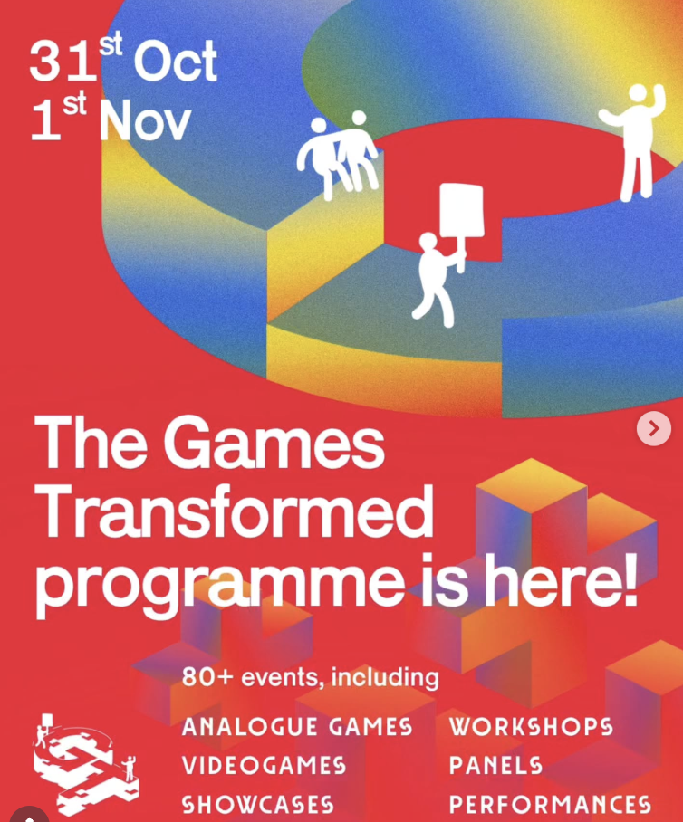

--- 
title: "'Technofascism and the Potential of Gameful Resistance' Panel Games Transformed Festival, London"

description: "The 2026 Games Transformed Festival explores how racial justice and migrant justice are part of the same fight, and how games can help us resist the forces that try and push our communities out."
date: 2026-10-31
endDate: 2026-10-31
tags: ['games', 'conference / symposium']
image: './261031_ GamesT.jpg'
---

In our panel "Technofascism and the potential of gameful resistance" at Games Transformed Festival, my collaborator Louis Cook and I will bring our insights from developing ['Sound, Sensors and Surveillance' a Bitsy game by Angela YT Chan and Louis Cook](https://angelaytchan.net/blog/2026/260922_ssslaunch/). We will be sharing alongside speakers from [Nijjor Manush](https://nijjormanush.com/) and the Save Brick Lane campaign(community organising group against data centre plans), [Open Rights Network](https://www.openrightsgroup.org/) ( the UK's largest grassroots digital rights campaigning organisation) and [Resistència Videolúdica](https://www.instagram.com/resistenciavideoludica/?hl=en), [David Gadelkarim](https://davidgadelkarim.com/index.html) and with our moderator [Max Haiven](https://maxhaiven.com/). 

It will be held at 10:15am, Saturday 31st October at Pelican House as part of the wider festival.

"This year's theme is Here to Stay, Here to Play. Inspired by the slogan “Here to Stay, Here to Fight” used by migrant and anti-racist communities as a statement of defiance against racism. The 2026 Games Transformed Festival explores how racial justice and migrant justice are part of the same fight, and how games can help us resist the forces that try and push our communities out.

Join game makers, activists, artists, and curious comrades to play, discuss, and challenge the systems shaping our world.

The schedule includes 80+ games, workshops, talks, experiments, and a dedicated youth and families programme." 

Read more about the [Games Transformed Festival](https://www.gamestransformed.org/) and tickets are available [here](https://www.tickettailor.com/events/gamestransformed/2328476) with a discount coupon HERETOFRIGHT. 

